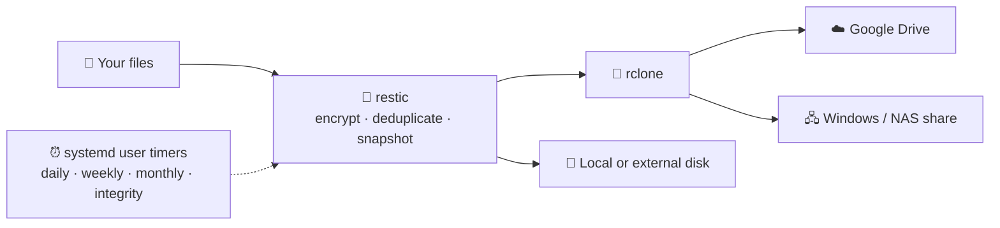

<div align="center">


# VaultLeaf Backup

**Easy, encrypted, automatic backups for Linux.**<br/>
A native GTK4 app built on [restic](https://restic.net) and [rclone](https://rclone.org): back up to Google Drive,
a Windows or NAS share, or any local disk, with no scripts and no terminal.

[](https://github.com/dillun-holmes-dev/linux-backup-app/releases/latest)
[](https://github.com/dillun-holmes-dev/linux-backup-app/releases)
[](LICENSE)


<br/>

<a href="https://github.com/dillun-holmes-dev/linux-backup-app/releases/latest/download/VaultLeafBackup-x86_64.AppImage"></a>
<a href="https://github.com/dillun-holmes-dev/linux-backup-app/releases/latest/download/VaultLeafBackup-aarch64.AppImage"></a>

<sub>One self-contained file: Python, GTK4, restic and rclone are all inside. No install, no admin password.</sub>

</div>

---

## Features

<table>
  <tr>
    <td width="50%" valign="top">📊 <b>Live overview</b><br/><sub>Progress, speed, ETA and the next scheduled runs, at a glance.</sub></td>
    <td width="50%" valign="top">🧭 <b>Guided setup</b><br/><sub>Five clear steps. Nothing changes until you click <b>Finish setup</b>.</sub></td>
  </tr>
  <tr>
    <td width="50%" valign="top">☁️ <b>Back up anywhere</b><br/><sub>Google Drive, a Windows or NAS share, or any local or external disk.</sub></td>
    <td width="50%" valign="top">🔐 <b>Encrypted &amp; verified</b><br/><sub>Encrypted, deduplicated snapshots, with weekly integrity checks.</sub></td>
  </tr>
  <tr>
    <td width="50%" valign="top">♻️ <b>Safe restore</b><br/><sub>Pick a date, restore all or part, and never overwrite by accident.</sub></td>
    <td width="50%" valign="top">🔁 <b>Never misses a backup</b><br/><sub>Interrupted or missed backups resume automatically.</sub></td>
  </tr>
  <tr>
    <td width="50%" valign="top">🛡️ <b>Signed updates</b><br/><sub>Every update is signature- and checksum-verified before it installs.</sub></td>
    <td width="50%" valign="top">🧹 <b>Keeps your data</b><br/><sub>Uninstalling never removes your backups or encryption keys.</sub></td>
  </tr>
</table>

## Quick start

1. **Download** the AppImage for your computer: [x86-64](https://github.com/dillun-holmes-dev/linux-backup-app/releases/latest/download/VaultLeafBackup-x86_64.AppImage) (most PCs) or [ARM64](https://github.com/dillun-holmes-dev/linux-backup-app/releases/latest/download/VaultLeafBackup-aarch64.AppImage).
2. **Run it.** Right-click → *Allow Launching* and double-click, or:
   ```sh
   chmod +x VaultLeafBackup-x86_64.AppImage
   ./VaultLeafBackup-x86_64.AppImage
   ```
   The first run installs a stable copy under `~/.local` with a menu entry.
3. **Open Backup plan**, follow the five steps, and you're protected. VaultLeaf keeps running from
   the tray, and closing the window doesn't stop your backups.

Already set up on this computer? A newer AppImage picks up your existing storage, folders, key and
schedules automatically, with no second setup.

## How it works



VaultLeaf creates a private restic password, the backup repositories and user-level systemd
schedules for you. Daily, weekly, monthly and integrity jobs can each be switched on or off, at
exact times, weekdays, a monthly date (1–28) or the last day of the month. Local destinations get
a small marker file: if a disk or network folder is missing, the backup stops instead of writing
to the wrong place.

## More details

<details>
<summary><b>Connecting Google Drive: easy or faster</b></summary>

<br/>

- **Easy shared rclone client:** browser sign-in only. It can be slower when many people share the
  default Google API quota.
- **Private Google API client JSON:** uses your own quota. Create a *Desktop* OAuth client in Google
  Cloud, add your account as a test user, download the JSON and select it in setup. The secret goes
  straight to rclone and is not copied into VaultLeaf's settings.

Then choose a **reliable**, **balanced** or **fast** connection profile. It controls rclone
concurrency, Drive upload chunk size, retries, cloud refresh frequency and how much repository data
the integrity check samples.

Cloud mode also creates `~/MyBackups/CloudDrive` and a persistent rclone mount that reconnects when
you sign in.
</details>

<details>
<summary><b>Windows and NAS shares (SMB)</b></summary>

<br/>

Enter the server, share and login, test the connection, and choose where it appears locally.
VaultLeaf creates a user service that reconnects after login (including after a reboot) and retries
network failures. The password is obscured in rclone's private configuration and is never copied
into VaultLeaf's JSON settings.
</details>

<details>
<summary><b>Running in the background, and integrity alerts</b></summary>

<br/>

Setup adds an autostart entry and a permanent user-local copy of the app. Closing the main window
hides it; backups and integrity checks continue. On desktops with a system tray, left-click the icon
to open the app and right-click for controls, including **Quit background app**. If your desktop
hides tray icons, a notification offers the same controls.

A weekly integrity timer checks the repository structure and samples stored data. A failure shows a
desktop notification and a blocking error popup, the tray icon asks for attention, and the output
appears in **Backups & logs**.
</details>

<details>
<summary><b>Excluding files and folders</b></summary>

<br/>

In **Settings**, choose **Add files…** or **Add folders…**. Paths are de-duplicated and saved
automatically. Advanced users can enter restic patterns directly. VaultLeaf refuses an exclusion
that would skip the entire backup source.
</details>

<details>
<summary><b>Restoring files</b></summary>

<br/>

**Restore runs as your user** and writes to the folder you choose (`~/Restored` by default). Daily,
weekly and monthly snapshots are all available. The flow never overwrites silently: it asks for
confirmation and can be cancelled at any time.
</details>

<details>
<summary><b>Updates and uninstalling</b></summary>

<br/>

**Settings → Application → Check for updates** downloads only the AppImage for your computer's
architecture. VaultLeaf first authenticates the release manifest with its embedded publisher key,
then refuses the file if its SHA-256 checksum doesn't match. See [SECURITY.md](SECURITY.md) to
verify signatures and build provenance by hand.

To uninstall, use **Settings → Application → Uninstall VaultLeaf**, or run:

```sh
vaultleaf-uninstall
# or: ./VaultLeafBackup-x86_64.AppImage --uninstall
```

Encryption keys, settings, logs and backup repositories are kept on purpose, so uninstalling can
never make an encrypted backup unreadable.
</details>

<details>
<summary><b>Requirements and where things are stored</b></summary>

<br/>

- **AppImage:** any 64-bit Linux desktop. Python, PyGObject, GTK4, restic, rclone and the update
  signature verifier are all bundled. FUSE is only needed for the optional mounted cloud folder.
- **From source:** Python 3.10+, PyGObject, GTK4, restic and rclone.
- New setups run as your user and need no administrator password (older root-based setups still use
  `pkexec`).
- Setup data: `~/.local/share/my-backups/`. Advanced configuration:
  `~/.config/my-backups/config.json`. No secrets are bundled in the AppImage.
</details>

<details>
<summary><b>Run from source and build the AppImage</b></summary>

<br/>

```sh
git clone https://github.com/dillun-holmes-dev/linux-backup-app.git
cd linux-backup-app
./run-my-backups.sh                  # or: PYTHONPATH=src python3 -m my_backups
```

Build the AppImage (needs `curl`; downloads `appimagetool` once):

```sh
bash packaging/build-appimage.sh     # → VaultLeafBackup-x86_64.AppImage
```

Build on the oldest Linux you want to support, because the core C library can't be safely bundled;
Ubuntu 22.04 is a good baseline. `./packaging/build-release.sh` makes a full release (AppImage,
portable archive and SHA-256 checksums), and `./packaging/build-compatible.sh` builds the Ubuntu
22.04 baseline in Docker on x86-64 or ARM64. See [docs/PORTABILITY.md](docs/PORTABILITY.md).

**Releasing:** set `VERSION` in `src/my_backups/metadata.py` and push a matching tag (e.g. `v1.5.0`).
`.github/workflows/release.yml` builds `x86_64` and `aarch64` natively and publishes both, with signed
checksums, release notes and verifiable build provenance.
</details>

## Contributing

Bug reports, ideas and pull requests are all welcome, from a one-line typo fix to a whole feature.

[](https://github.com/dillun-holmes-dev/linux-backup-app/issues/new?template=bug_report.yml)
[](https://github.com/dillun-holmes-dev/linux-backup-app/issues/new?template=feature_request.yml)
[](https://github.com/dillun-holmes-dev/linux-backup-app/issues)
[](https://github.com/dillun-holmes-dev/linux-backup-app/pulls)

`main` is protected: changes land through a reviewed pull request. See [CONTRIBUTING.md](CONTRIBUTING.md).

## Support

VaultLeaf Backup is free and open source. If it saves your files, you can support it, though it's
entirely optional:

[](https://github.com/sponsors/dillun-holmes-dev)

## Acknowledgements

Thanks to [**Crypticat**](https://github.com/Crypticat) for the inspiration behind VaultLeaf Backup.
What started as a collection of shell scripts became a proper app.

## License

Copyright 2026 dillun-holmes-dev. Licensed under the [Apache License, Version 2.0](LICENSE).
